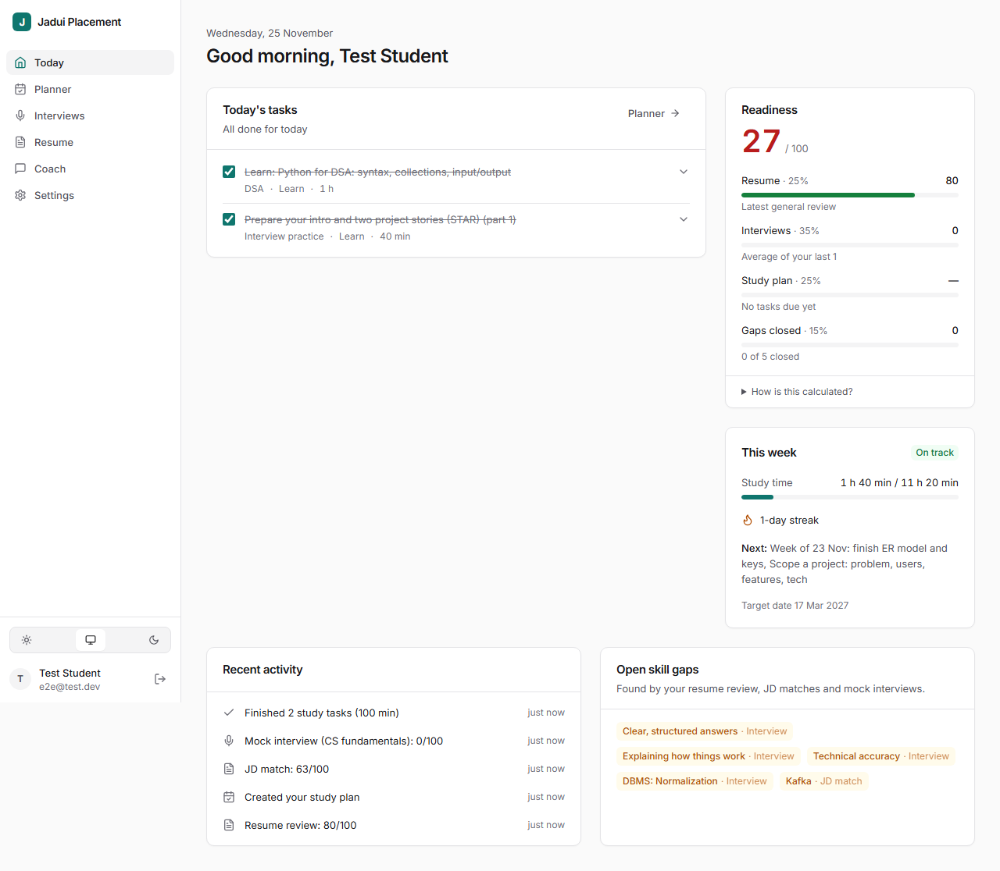
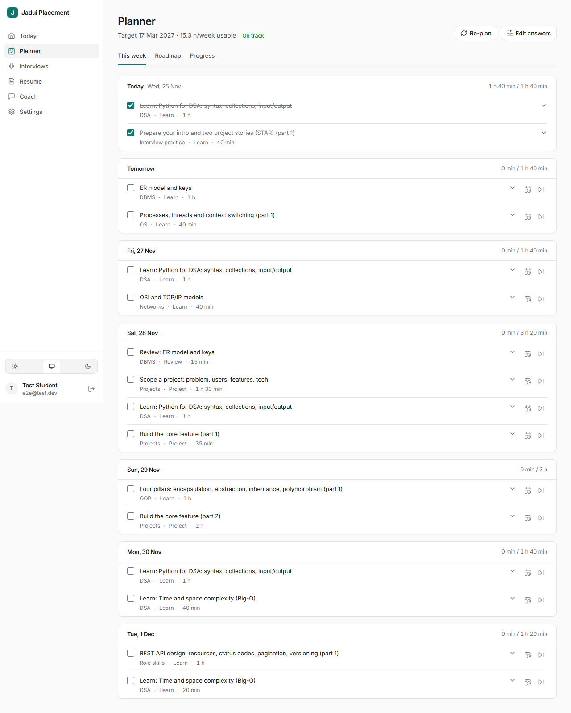
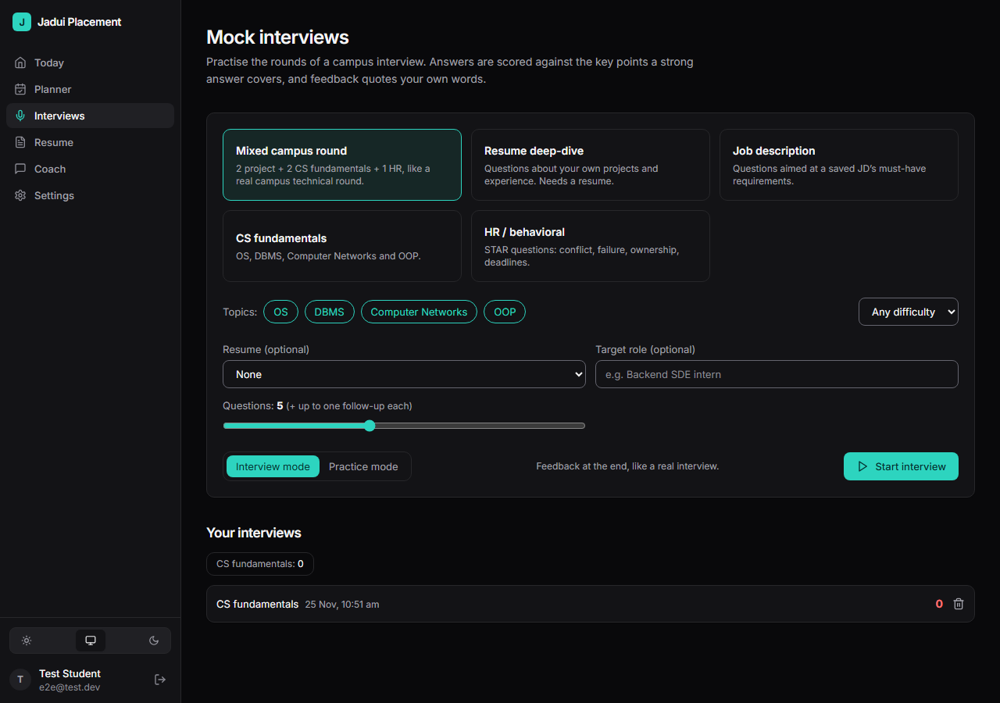

# Jadui Placement


**Jadui Placement** helps students prepare for software engineering placements. It brings four things together
and feeds each into the next:
- a **study plan** built around your real week
- **mock interviews** scored with evidence
- an honest **resume review**
- a **coach** that answers from your own progress

| Today | Planner | Mock interviews (dark theme) |
|:---:|:---:|:---:|
|  |  |  |

| Part | What it does | Status |
|:---|:---|:---|
| Study planner | 5-question profile → dated roadmap across DSA, OS, DBMS, CN, OOP, LLD/HLD, projects (+ aptitude for service companies) | **v2** |
| Mock interviews | Resume, JD, CS fundamentals and HR tracks; key points credited only with quotes from your answer | **v2** |
| Resume screener | Layout-aware parsing, parse-health checks, truth-guarded review, evidence-cited JD match | **v2** |
| Coach | Chat grounded in your data; proposes actions you confirm with a click | **v2** |
| Today dashboard | Readiness with a visible formula, today's tasks, next actions, activity | **v2** |

**Principle across the app:** code does what can be computed (schedules, scores, checks), and the LLM does only
what needs language. Every LLM output is schema-validated and checked against your data before you see it.

---

## Architecture

```
Next.js 14 (TypeScript, React Query, in-house UI kit, light + dark themes)
        |  Supabase Auth session -> Bearer JWT on every request
FastAPI (Python 3.13)
  app/core       auth (JWT/JWKS), errors, user-scoped data layer
  app/llm        one LLM client: versioned prompts, schema validation, repair retry, Gemini -> Groq, call log
  app/resume     resume screener            app/interview  mock-interview engine
  app/planner    curriculum + scheduler     app/coach      grounded chat with checked actions
  app/dashboard  readiness, next actions, delete-my-data
        |
Supabase: Postgres with row-level security, private Storage, Auth
```

Study guides (design decisions, formulas, interview Q&A):
- [Resume screener](docs/learn/resume-screener-guide.md)
- [Mock interviews](docs/learn/mock-interview-guide.md)
- [Task planner](docs/learn/task-planner-guide.md)
- [Dashboard, coach and UI system](docs/learn/product-guide.md)

---

## Study Planner (v2)

```
questionnaire -> topic selection (level, role, company type, year, self-ratings, gaps, interview scores)
  -> calendar (weekday/weekend hours × 0.85, rest day, busy dates) -> fit or cut, with a suggestion
  -> deterministic scheduler: weighted interleaving, prerequisites, spaced reviews (+2/+7/+21 days), mock checkpoints
  -> 14 days of dated tasks, re-planned from what you actually did
```

- **Code plans, the LLM explains.** LLMs fail at multi-constraint planning (0.6% on TravelPlanner), so a tested
  scheduler owns every date and hour. The LLM writes the roadmap summary and project ideas, which are validated (no
  numbers, only subjects in the plan, tech from your stack or gaps).
- **Honest about time.** A 15% buffer up front; weekly check-ins re-plan with your real completion rate. If the goal
  doesn't fit, it says what was cut and how many extra hours or weeks would fit it.
- **Tested.** Property tests over generated profiles (never over a day's capacity, prerequisites first, reviews
  spaced) plus an 8-persona eval in CI.

## Coach

- Answers from a server-built snapshot of your plan, tasks, scores and gaps.
- Can propose up to three actions (open a page, start an interview, mark or move a task, re-plan). They're buttons:
  nothing runs until you click, and the proposals are validated in code (OWASP LLM06, excessive agency).

---

## Resume Screener (v2)

The first pillar rebuilt from scratch (`backend/app/resume`, `frontend/src/features/resume`).

```
upload -> layout-aware text extraction -> 16 parse-health checks -> PII redaction
       -> LLM structuring + grounding check -> general review  or  JD match -> documented score
```

- **Deterministic first.** 75/100 of the general score is computed by rules; the LLM rates substance on an
  anchored 1-5 rubric. Every sub-score shows its formula in the UI.
- **Grounded AI output.** Every bullet the LLM extracts must exist in the original text; every requirement
  marked as met quotes the bullet that proves it.
- **Truth guard.** Suggested rewrites can rephrase but never add numbers, technologies, companies or
  leadership claims. Missing metrics become `[X]` placeholders plus coach questions.
- **Bias reduction.** Name and contact details are redacted before any LLM call.
- **Engineering.** Pydantic-validated LLM layer (repair retry, Gemini->Groq fallback, call logging,
  versioned prompts), user-scoped data access + Supabase RLS, content-hash caching, 107 resume tests,
  Playwright E2E, eval harness on labeled cases, GitHub Actions CI.

Study guide with design decisions and formulas: [docs/learn/resume-screener-guide.md](docs/learn/resume-screener-guide.md)

---

## Mock Interviews (v2)

The second pillar (`backend/app/interview`, `frontend/src/features/interview`).

```
pick a track -> plan questions (resume / JD via 1 LLM call with grounding, or the curated bank)
  -> answer (text or voice) -> judge: key points + anchored 1-5 rubric -> at most one follow-up -> report
```

- **Campus-style tracks:** resume deep-dive, JD-based, CS fundamentals (OS, DBMS, CN, OOP), HR/STAR, or a
  mixed round.
- **Evidence-based scoring.** Each dimension has a written 1-5 scale. A key point counts only if the judge quotes
  the answer and code verifies the quote is really there. Score = 60% rubric + 40% key-point coverage.
- **Hard to game.** Padding and prompt-injection answers are adversarial eval cases; the answer key never
  reaches the browser.
- **Connected.** Missed topics are written to `skill_gaps`, next to the resume screener's gaps, for the planner.
- **Engineering.** Pure state machine for the turn flow, background judging with polling, 32 tests, Playwright
  E2E, eval harness with hand-labeled answers.

Study guide: [docs/learn/mock-interview-guide.md](docs/learn/mock-interview-guide.md)

---

## Technology Stack

| Layer | Technology |
|:---|:---|
| **Frontend** | Next.js 14, TypeScript, Tailwind CSS (CSS-variable design tokens), React Query, Playwright |
| **Backend** | FastAPI, Pydantic v2, Uvicorn, PyMuPDF, RapidFuzz |
| **Database** | Supabase (Postgres with RLS, Storage, Auth) |
| **LLM** | Gemini (primary) + Groq (fallback), schema-validated structured output |
| **Quality** | pytest (200+ tests), ruff, ESLint, typecheck, 4 Playwright E2E flows, 3 eval harnesses, GitHub Actions CI |

---

## Getting Started

### Prerequisites
- Node.js 18+ and Python 3.13
- A Supabase project (apply every file in `supabase/migrations/`, in order)
- API keys: `GEMINI_API_KEY` (and optionally `GROQ_API_KEY` for the fallback)

### Environment
- Backend: copy `.env.example` to `backend/.env`.
- Frontend: copy `frontend/.env.local.example` to `frontend/.env.local`.

### Backend

```bash
cd backend
python -m venv .venv
source .venv/bin/activate       # Windows: .venv\Scripts\activate
pip install -r requirements-dev.txt
uvicorn app.main:app --reload   # http://localhost:8000, health check: GET /health
pytest -q
```

No keys yet? Run with `DATABASE_BACKEND=memory LLM_PROVIDER=fake` to use an in-memory database and canned
AI answers.

### Frontend

```bash
cd frontend
npm install
npm run dev                     # http://localhost:3000
```
